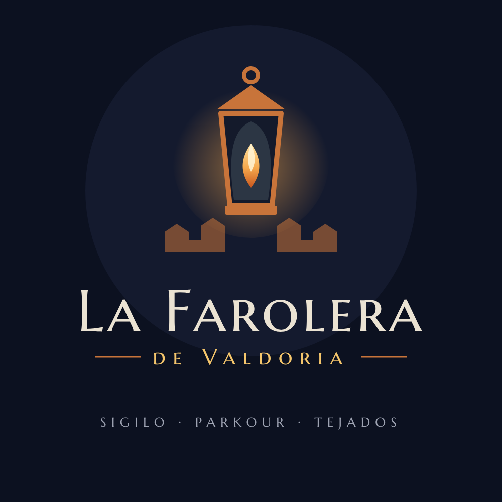

# La Farolera de Valdoria

Juego 3D de sigilo y parkour en tercera persona que se juega en el navegador. Eres Lira, la última del Gremio de la Mecha: trepa por los tejados de Valdoria, apaga los faroles que vigilan la ciudad y elimina a los agentes del Regente Malvor en tres niveles.

## Cómo jugar

- **En línea:** activa GitHub Pages en este repositorio (Settings → Pages → rama `main`, carpeta raíz) y abre la dirección que te dé GitHub.
- **En tu computadora:** abre `index.html` en un navegador moderno. Necesitas internet para cargar Three.js y las fuentes.

Funciona con teclado y ratón, con mando de Xbox y con pantallas táctiles en horizontal. Los controles completos, las mecánicas y los niveles están en [MANUAL.md](MANUAL.md).

## Contenido

| Archivo | Qué es |
| --- | --- |
| `index.html` | El juego completo en un solo archivo |
| `assets/logo-la-farolera.svg` | Logo en vector, con la fuente incluida |
| `assets/logo-la-farolera.png` | Logo en PNG de 1000 × 1000 px |
| `MANUAL.md` | Manual de juego |

## Tecnología

- [Three.js](https://threejs.org/) r128, cargado desde cdnjs.
- Las texturas, los personajes y el sonido se generan con código. El juego no usa imágenes ni audios externos.
- Fuentes: Marcellus SC y Alegreya Sans, de Google Fonts.
